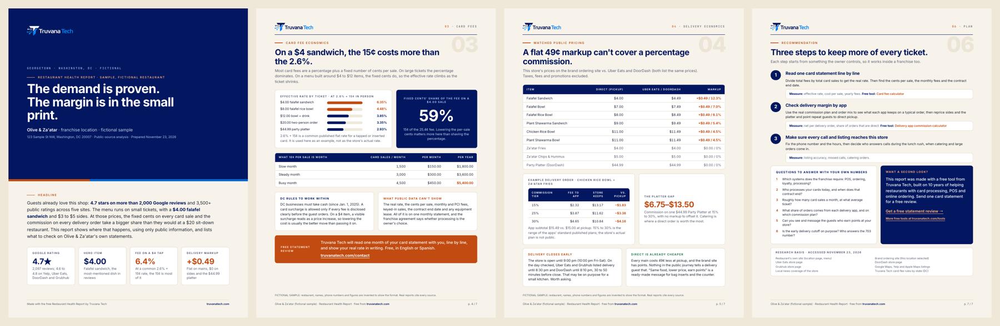

# Restaurant Health Report: an AI agent skill

**A quick check-up that shows a restaurant where to start: switch card processors, add a kiosk, get help with reviews, or cut delivery-app costs.**

Give your AI agent a restaurant's name. About 30 minutes later you get a 7-page report, built only from public sources. It covers how the restaurant's reviews compare with nearby restaurants, what card fees and delivery apps really cost at its ticket sizes, and listing mistakes the owner can fix this week for free.

### Why we built it

[Truvana Tech](https://truvanatech.com?utm_source=github&utm_medium=readme&utm_campaign=restaurant-health-report) reached out to more than 6,000 merchants and tested many payment solutions along the way. What we heard again and again:
- **Owners watch only the card rate.** Almost nobody looks at their effective rate, their delivery margins or their marketing as a whole.
- **Nobody knows whether their reviews are good or bad compared with the restaurants around them.**
- **Few know where to start improving.** Is it the processor? Labor at the counter? Reputation?

We knew the analysis that answers those questions, so we wrote it down as an AI skill anyone can run.

**It's a check-up, not a full service.** If you want to go deeper, the Truvana Tech team is happy to meet, walk through your restaurant with you, and suggest what to improve first.

Works with **Claude Code** and **OpenAI Codex**. Free and open source.



*Pages from the [sample report](skills/restaurant-health-report/examples/sample-falafel/sample-report.pdf). The restaurant in it is fictional.*

**[See the full guide for owners and ISOs on truvanatech.com →](https://truvanatech.com/tools/restaurant-health-report?utm_source=github&utm_medium=readme&utm_campaign=restaurant-health-report)**

---

## Install

**Claude Code**: paste this into Claude Code:

```
/plugin install restaurant-health-report --marketplace YangzhenRuan/restaurant-health-report
```

**Codex, Cursor and other agents**: run this in Terminal (uses [skills.sh](https://skills.sh)):

```bash
npx skills add YangzhenRuan/restaurant-health-report
```

**No Node.js?** Paste this sentence into Claude Code or Codex instead:

```
Install the restaurant-health-report skill from https://github.com/YangzhenRuan/restaurant-health-report (copy its skills/restaurant-health-report folder into my skills folder), then build the sample report from its examples folder to check that it works.
```

Or run the installer script, which installs for both Claude Code and Codex:
`curl -fsSL https://raw.githubusercontent.com/YangzhenRuan/restaurant-health-report/main/install.sh | bash` on Mac or Linux, or
`irm https://raw.githubusercontent.com/YangzhenRuan/restaurant-health-report/main/install.ps1 | iex` in Windows PowerShell.

**You also need:**
- [Python 3](https://www.python.org/downloads/): already on most Macs.
- Google Chrome or Microsoft Edge: used to make the PDF.

Nothing else to install.

## Use

Paste this, with your restaurant filled in:

```
Make a restaurant health report for <restaurant name>, <website or street address>.
```

Add anything you know, such as "I'm the owner" or "it's a franchise location". The agent then:

1. **Researches** the restaurant's own site, its online ordering page, Uber Eats, DoorDash, Grubhub, Google Maps, Yelp, Apple Maps and nearby competitors.
2. **Logs evidence**: every fact goes into `evidence.md`, with the link it came from.
3. **Builds the PDF**: a script does all the arithmetic and the layout.
4. **Checks its own work**: layout overflow, hand-typed numbers, and a quality checklist.
5. **Hands you** the PDF, a 5-line summary and a short "double-check" list.

A report takes about 30–45 minutes of agent time. If the agent has a browser (Claude in Chrome, or Codex's browser tool), it can read delivery apps and review sites that block plain fetches.

## What's in the report

| Page | What it shows |
|---|---|
| 1. Cover | The headline finding and four key numbers |
| 2. Snapshot | Hours, ordering, loyalty, POS and card rules, each tagged Verified / Verify / Not confirmed / Not public |
| 3. Demand | Ratings by site, recurring review themes, and how you rank against nearby restaurants |
| 4. Card fees | The effective card rate at the restaurant's real ticket sizes, and what a small improvement is worth |
| 5. Delivery | The same items priced direct vs. on the apps, and what each commission tier keeps |
| 6. Free fixes | Wrong phone numbers, mismatched hours, broken links, unpriced items |
| 7. Where to start | Switch processors? Add a kiosk? Reputation help? Cut delivery costs? Each one rated by the evidence, with a first step |

## Rules the skill never breaks

- **Only what it saw.** Every fact comes from a page the agent opened. Search snippets don't count.
- **Honest tags.** Guesses are labelled as guesses. Anything that can't be known from outside is marked "Not public".
- **No invented numbers.** A script computes rates, markups and commissions. The build flags any `$` or `%` typed by hand.
- **Browse, never buy.** No checkout, no sign-in, no accounts, no CAPTCHAs.

## Repository layout

```
skills/restaurant-health-report/
  SKILL.md               instructions the agent follows
  scripts/build_report.py   data.json → report.html (all arithmetic, embedded fonts)
  scripts/render_pdf.py     report.html → PDF, with a layout overflow check
  references/            research playbook, data schema, QA checklist, card-fee rules
  examples/sample-falafel/  a complete fictional example (data.json + PDF)
install.sh / install.ps1  one-line installers
```

You can also run the scripts without an agent:

```bash
python3 skills/restaurant-health-report/scripts/build_report.py path/to/data.json
python3 skills/restaurant-health-report/scripts/render_pdf.py path/to/report.html --preview
```

## Free tools from Truvana Tech

Every report links to these free tools, which help with the follow-up questions:

- [Credit card processing fee calculator](https://truvanatech.com/tools/card-fee-calculator?utm_source=github&utm_medium=readme&utm_campaign=restaurant-health-report): your real rate from two numbers on your statement
- [Delivery app commission calculator](https://truvanatech.com/tools/delivery-app-commission-calculator?utm_source=github&utm_medium=readme&utm_campaign=restaurant-health-report)
- [Credit card surcharge and cash discount checker](https://truvanatech.com/tools/credit-card-surcharge-checker?utm_source=github&utm_medium=readme&utm_campaign=restaurant-health-report): the rules for every state
- [Processor contract exit cost calculator](https://truvanatech.com/tools/processor-contract-exit-cost?utm_source=github&utm_medium=readme&utm_campaign=restaurant-health-report)
- [Free card statement review](https://truvanatech.com/contact?utm_source=github&utm_medium=readme&utm_campaign=restaurant-health-report), in English or Spanish, for restaurants in DC, MD and Northern VA

## About Truvana Tech

[Truvana Tech](https://truvanatech.com?utm_source=github&utm_medium=readme&utm_campaign=restaurant-health-report) is a local team in DC, Maryland and Northern Virginia. It installs POS systems and card machines for restaurants and small businesses, and supports owners in English or Spanish.

Every report made with this skill ends with an offer to meet with the Truvana Tech team for a deeper look. That part is optional and free.

## License

MIT for the code and docs. The Truvana Tech name and logo are not covered by the license. The fonts are licensed under the SIL Open Font License. See [LICENSE](LICENSE).

Card-fee rules in the skill are summaries of public rules, not legal advice.
